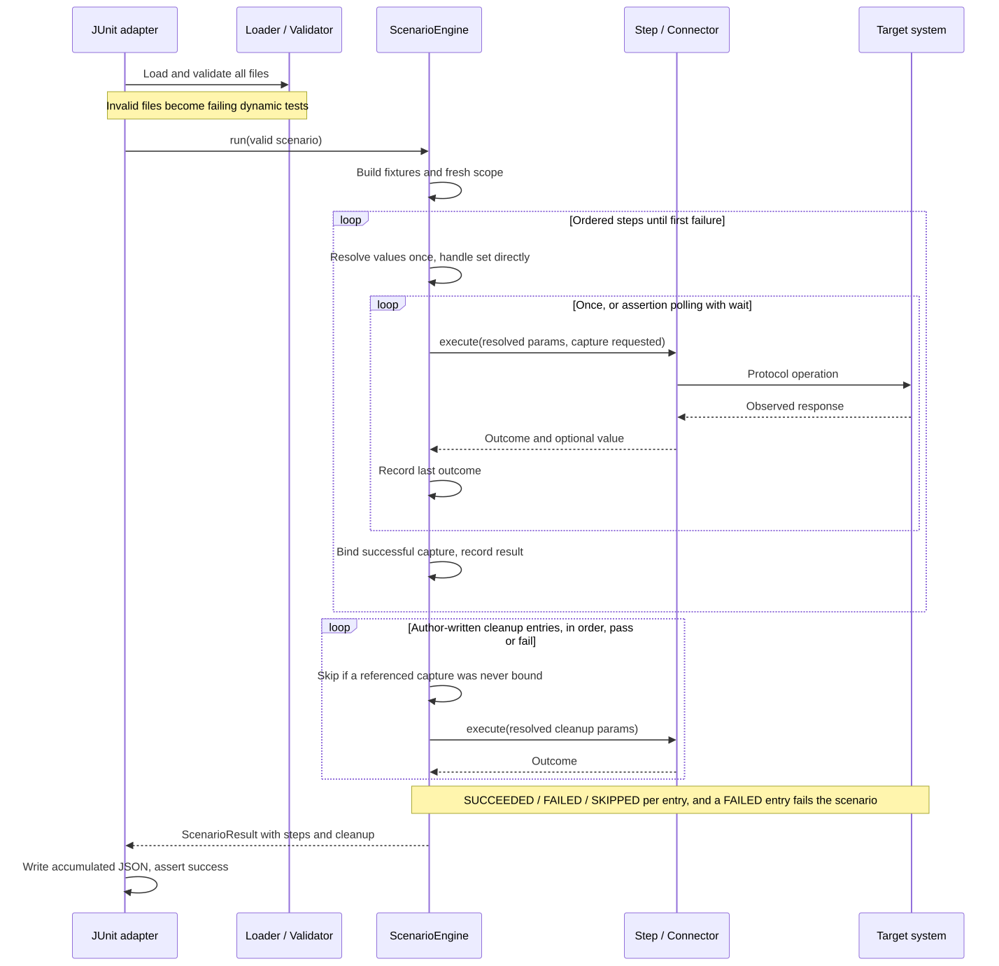

# Architecture guide

This guide explains the framework at code revision `104e388a555f9e22d0c415290ff2edc606402a59`, reviewed on 2026-09-15. Start with the [overview](../overview.md) for the project purpose. Use the [capability matrix](capabilities.md) for implementation evidence and the [specification](../reference/specification.md) for the maintained behavior contract.

## 1. Scope and constraints

The framework is a set of Java libraries and JUnit tests with a declarative YAML authoring layer. It tests identity-related operations across heterogeneous protocols. Asynchronous propagation is central: an assertion may need repeated observations before it succeeds.

The design keeps two authoring tiers, reuses connectors, and separates execution from reporting. The YAML engine owns orchestration explicitly; Java workflows orchestrate their own calls. See [ADR 0001](decisions/0001-two-authoring-tiers.md) and [ADR 0002](decisions/0002-purpose-built-engine.md).

Current constraints are Java 21, Maven modules, Spring-based connector wiring and JUnit execution. A CLI, UI, HTML renderer, parallel scenario scheduling and cross-file step reuse are outside the delivered scope. The existence of a connector is not evidence that a corresponding YAML operation exists.

## 2. System context

Consultants author YAML; developers can author Java and extend the framework. The framework sends operations to target systems and compares observed state with expected state. Identity Manager itself is external to the framework. The framework does not implement provisioning or replace the system being tested.

The current suite simulates workflows against local LDAP, H2 and WireMock. To test an actual provisioning chain, a future real-environment workflow must trigger a change in IdM and observe downstream effects without performing the downstream write itself.

## 3. Runtime boundaries

A test JVM contains JUnit, the Spring context, scenario execution code and connectors. Libraries inside it are not separately deployed services. Maven may launch separate test JVMs per module; the diagram is a logical runtime view of one test process.

YAML and compiled test classes are inputs. JSON and Surefire reports are file outputs, not database services. External interactions cross LDAP, JDBC or HTTP boundaries. For the embedded scenarios, some logical targets are hosted inside the same JVM; the environment view below makes that distinction explicit.

`ScenarioEngine` takes its registry, fixture factory, executor, default timeouts and evaluator by constructor. It does not load Spring configuration. The JUnit adapter is the composition point: it obtains Spring-managed collaborators and constructs the engine. This is source-level independence, not a Spring-free transitive dependency graph. See [ADR 0003](decisions/0003-engine-runtime-independence.md).

## 4. Building blocks and dependency direction

| Building block | Responsibility | Source |
|---|---|---|
| JUnit adapter | Discover/validate files, select them with `-Dscenario`, construct registry, run dynamic tests, write results | [YamlScenarioTest](../../idm-test-scenarios/src/test/java/com/idm/test/scenarios/engine/YamlScenarioTest.java) (embedded run), [ScenarioSupport](../../idm-test-scenarios/src/test/java/com/idm/test/scenarios/engine/ScenarioSupport.java) (shared helpers) |
| Other runners | The same adapter against containers, or against a real lab behind five guards | [ContainerScenarios](../../idm-test-scenarios/src/test/java/com/idm/test/scenarios/engine/ContainerScenarios.java), [RealEnvironmentScenarios](../../idm-test-scenarios/src/test/java/com/idm/test/scenarios/engine/RealEnvironmentScenarios.java) |
| Loader | Parse YAML into scenario records | [ScenarioLoader](../../idm-test-engine/src/main/java/com/idm/test/engine/ScenarioLoader.java) |
| Validator | Check known steps, parameters, references and expression syntax | [ScenarioValidator](../../idm-test-engine/src/main/java/com/idm/test/engine/ScenarioValidator.java) |
| Engine | Scope, ordered execution, waiting, capture and cleanup lifecycle | [ScenarioEngine](../../idm-test-engine/src/main/java/com/idm/test/engine/ScenarioEngine.java) |
| Value handling | Fixture generation, interpolation and restricted expression evaluation | [Engine source directory](../../idm-test-engine/src/main/java/com/idm/test/engine/) |
| Step interface | Declare metadata and execute one operation | [StepType](../../idm-test-engine/src/main/java/com/idm/test/engine/spi/StepType.java) |
| Steps | Adapt the LDAP, database, SOAP and REST/HTTP connectors to YAML (14 step types) | [Step implementations](../../idm-test-engine/src/main/java/com/idm/test/engine/steps/) |
| Core | Shared operation result/error model and polling utility | [Core sources](../../idm-test-core/src/main/java/com/idm/test/core/) |
| Results | Scenario/step data and JSON serialization | [Result sources](../../idm-test-engine/src/main/java/com/idm/test/engine/result/) |

The engine depends on core, utils and the LDAP, database, SOAP and REST connectors; it still imports no Spring type itself. Connectors share core types; they do not depend on the engine. The placeholder `idm-connector-idm` module should not be drawn as an implemented IdM service.

### Protocol implementations

LDAP uses Spring `LdapTemplate` and configured context sources. JDBC uses a named map of `JdbcTemplate` objects, each backed by a Hikari pool. Queries are raw SQL; there is no domain entity persistence layer.

The REST module includes the configured Spring `RestClient`, `IdmRestConnector` and `RestAuthenticator`. The client runs on the JDK `HttpClient` pinned to HTTP/1.1, with a default 10-second connect timeout and 30-second overall read deadline; each target's `connect-timeout`/`read-timeout` apply (one client per distinct pair). `RestAuthenticator` turns a target's settings into its `Authorization` header: basic, or an OAuth2 client-credentials token from Spring Security's authorized-client manager, or none.

SOAP role and resource connectors use WSDL-generated JAX-WS ports. Constructors set endpoint addresses and, when `idm.test.soap.username`/`password` are set, HTTP basic authentication; `connection-timeout`/`read-timeout` are applied to both ports. The resource connector is conditional on `idm.test.soap.resource-url`, absent from the default scenario configuration. These distinctions matter when assessing real-environment readiness.

## 5. Execution flow

### Before execution

The adapter lists `.yaml` files in filename order. It loads and validates every discovered file before dynamic test execution starts. A malformed file becomes a failing test with a scenario-level result rather than hiding valid files.

Validation checks syntax and declared names without executing expressions. It catches missing required step keys and unknown top-level step parameters, but is not a full schema validator. For example, some nested type errors and missing map properties surface only while running. An arbitrary JavaScript variable can be syntactically valid yet absent at runtime.

### During execution

A scenario gets a fresh scope seeded by fixtures. Literal fixture values override generated values. Each ordinary step's parameters are resolved once. The engine removes its own `as` and `wait` fields before calling the step, and passes only a boolean indicating whether capture is required.

`set` is an engine keyword, not a connector action. It binds entries in declaration order. A later entry can read an earlier entry from the same step. Validation rejects rebinding an existing fixture/variable.

A step returns `StepOutcome(success, message, value)`. The engine binds a non-null value only on success when capture was requested. No step registers teardown of its own any more; an author who needs it writes an explicit top-level `cleanup:` block (see [ITF-19](../specs/2026-09-24-explicit-cleanup-design.md)). `ldap.create` returns the new relative DN. `ldap.verify` does an extra read for captures only when requested; its output is a selected attribute map, not a general directory export.

### Waiting and failure

Actions run once. An assertion with `wait` is polled using the same resolved parameters until success or timeout. Expressions are not reevaluated on each attempt. The timeout governs polling; protocol client calls have their own blocking/timeout behavior.

Failed outcomes and handled runtime exceptions stop later steps. A retrying assertion records its latest outcome and attempts. No synthetic results are created for later unexecuted steps. See [ADR 0004](decisions/0004-assertion-retries-and-cleanup.md).

### Cleanup

> **Superseded by ITF-19** (docs/specs/2026-09-24-explicit-cleanup-design.md): steps no longer register undos; teardown is the author's cleanup: block, and a FAILED cleanup entry fails the scenario.

The engine infers no teardown. A scenario may declare a top-level `cleanup:` block: a list of
action steps, run after `steps:` regardless of pass or fail, in declaration order, with every
entry attempted even if an earlier one fails. Each entry resolves to `SUCCEEDED`, `FAILED`, or
`SKIPPED` (a reference to a name that a step which never ran would have bound via `as:`). A
`FAILED` cleanup entry fails the scenario, but a step failure still leads the failure summary.

This is compensation the author writes, not a distributed transaction and not something the engine
infers from the steps it ran. Java tests use a separate base-class cleanup mechanism, whose
role-removal path is currently a logging placeholder.

## 6. Result model and reporting

[ADR 0005](decisions/0005-structured-results.md) records the choice to return structured data. `ScenarioResult` describes the scenario; `StepResult` describes each executed step. The adapter serializes accumulated results after every dynamic test and asserts success through JUnit.

Scenario duration includes fixture preparation and cleanup. Step durations do not necessarily sum to it. JSON step indices are zero-based; human failure summaries use one-based step numbers. Waited results include attempts and waited milliseconds; the last observed outcome is described in the message rather than a separate field.

The JSON writer belongs to the engine module but is called by the adapter. `ScenarioEngine.run()` itself writes no report files. JSON write failures can still fail the JUnit test. Parallel execution and atomic concurrent report publication are not promised.

Resolved parameter values are included without redaction. Shared examples and demonstration results should use synthetic identity data. Reports describe YAML runs; Surefire reports cover the wider Java suite as well.

## 7. Expressions and state isolation

[ADR 0006](decisions/0006-restricted-expressions.md) describes whole-value Rhino ES6 expressions. Scope values become native JavaScript values, Java class access is denied, and each evaluation gets a new scope. There is no custom `dates` or `strings` helper object in the current implementation.

Instruction observation stops runaway script loops at the configured threshold, defaulting to 100,000 instructions. Conversion guards reject cycles and overly deep/large structures. Tests exercise these controls. They are not OS isolation or a blanket upper bound on heap allocation and wall-clock time. Standard JS time and randomness remain possible, so “computes values” does not imply determinism.

The `${path}` mechanism is independent of JS. It resolves map paths into strings. A whole-value expression can instead produce a number, boolean, map or list. The outer expression parser has known limitations for some regex literals with structural characters; see the authoring guide.

## 8. Execution environments and configuration

The bundled scenario base activates `test`, starts UnboundID and WireMock, and supplies dynamic LDAP/role SOAP properties. The test profile uses H2 databases. `TestSchemaInitializer` initializes the `test-db` schema explicitly because those data sources are held inside the named-template map rather than exposed for ordinary Spring SQL initialization.

The optional Docker Compose file is for manual exploration. It is not a prerequisite for the current suite. Selected eDirectory-like schema additions and SOAP stubs give useful framework checks without establishing vendor compatibility.

Two runners take the YAML scenarios beyond the embedded base. `ContainerScenarios` (optional, needs Docker) runs the corpus against OpenLDAP, PostgreSQL and WireMock via Testcontainers. `RealEnvironmentScenarios` runs the scenarios in `scenarios-real/` under the profile and credentials you supply; five guards refuse the embedded profile, placeholder URLs, an empty directory, placeholder REST targets and placeholder or half-given credentials before anything runs. The diagram above predates both runners.

`dev`, `test` and `prod` configuration documents exist; the embedded overrides stay in the scenario base, so a real environment goes through `RealEnvironmentScenarios`, with test identities and `cleanup:` blocks written for that environment. See [configuration](../reference/configuration.md) and [running tests](../reference/running-tests.md).

## 9. Extending the architecture

To add a YAML operation, implement `StepType`, declare its required/accepted parameters, choose whether it is retryable, and return an appropriate outcome and capture value. Register it in the adapter and use that same registry for validation and execution. Add the connector dependency to the engine when necessary. A retryable step should observe state rather than repeat a mutation. Steps do not register undo; if teardown is needed, an author writes it as a `cleanup:` entry.

To add a reporting surface, consume the result model outside `ScenarioEngine.run()`. To add a new runner, supply dependencies and default policy at a composition point rather than moving application context creation into the engine.

The [authoring guide](../guides/scenario-authoring.md) explains the current step contract. Preserve the import boundary, visible execution order, explicit capture behavior and result diagnostics when extending it.

## 10. Current risks and deferred work

The [capability matrix](capabilities.md) is the authoritative status list. The key limitations for coworkers are narrow YAML coverage, incomplete real-environment authentication/wiring, best-effort cleanup, and no real IdM validation in the current baseline. CLI/UI/reporting and broader YAML vocabulary are separate work.

Maintain these diagrams and documents when changing module dependencies, step registration, syntax, result shape or environment wiring. Keep ADRs as rationale and mark superseded decisions explicitly; do not silently rewrite historical intent into an implementation claim.
