# IdM Test Framework

## What problem does it solve?

An identity change rarely stays in one place. Creating a user or assigning a role in an Identity Management (IdM) system may need to update a directory, an application database, and an API. That propagation is called **provisioning**. It can take time, and a successful request does not necessarily mean every target has reached the expected state.

This project provides reusable tools for describing those workflows and checking their results. A **scenario** is a sequence of actions and checks. A **connector** performs an operation against a directory, database or service. An **assertion** checks that the observed state matches the expected state; assertions can poll while provisioning finishes.

## Who uses it?

| Audience | How they work |
|---|---|
| IdM consultants and test authors | Write a YAML scenario using supported steps |
| Developers | Write Java/JUnit workflows, add connectors or extend the YAML vocabulary |
| Reviewers and teammates | Read the ordered workflow and examine its failure details |

The two authoring paths share connectors. A connector improvement can benefit both. Java remains useful for operations that do not yet have a YAML step and for workflows requiring more control.

## The big picture



The diagram describes the integration boundary. The current local suite substitutes embedded LDAP, H2 databases and stubbed SOAP responses for external infrastructure. The dashed Identity Manager relationship is a real-environment target, not a claim that the local suite connects to a vendor IdM installation.

## A small scenario

This example creates a directory entry, verifies an attribute, and asks the engine to retry the check for up to 30 seconds:

```yaml
name: Create and verify a directory user
fixtures:
  user:
    generate: random-user
steps:
  - ldap.create:
      dn: "cn=${user.userId},ou=users"
      as: created
      attributes:
        cn: ${user.userId}
        sn: ${user.lastName}
        givenName: ${user.firstName}
  - ldap.verify:
      dn: ${created}
      expect:
        givenName: ${user.firstName}
      wait: { timeout: 30s, poll: 2s }
```

The fixture generates test data. `${...}` substitutes a value, and `as: created` saves the new entry's distinguished name (DN). Here the DN is relative to the configured directory base. After execution, the create step's registered cleanup attempts to delete that entry.

The bundled example adds an expression for a display name. Expressions compute values; connector operations remain visible as steps. See the [authoring guide](guides/scenario-authoring.md) for a runnable walkthrough.

## What happens during a run?

1. JUnit discovers scenario files and validates them before their steps run.
2. The engine prepares data, resolves each step's values, and executes steps in order.
3. Assertions with `wait` poll until success or timeout. A failed step stops later steps.
4. The engine attempts registered cleanup and returns a structured result.
5. The JUnit adapter records the result in JSON and exposes success or failure through normal test reports.

Failures identify the file and step. A waiting assertion records the attempt count and elapsed wait, helping an author distinguish an immediate error from a target that never reached the expected state.

## What is available today?

- 13 YAML step types across LDAP, databases, SOAP roles and resources, REST and raw HTTP; fixtures, `${path}` references, restricted JavaScript expressions, `set` variables, `as` captures and an explicit `cleanup:` block.
- Java connectors for LDAP, raw SQL databases, REST, and SOAP role/resource operations.
- JUnit execution and JSON results; embedded local test infrastructure without Docker; optional runners for containers and for a real lab.
- Authentication from configuration: basic or OAuth2 client credentials for REST targets, basic for SOAP.

HTTP responses are checked with JavaScript conditions, reading JSON and XML bodies as plain objects (ITF-24, ITF-25). CLI, frontend and HTML reporting are deferred.

The [capability matrix](architecture/capabilities.md) records exact status and source evidence. Its 2026-09-25 review ran 591 tests successfully. That count is a dated snapshot, not a promise about later revisions.

## What does the demonstration prove?

It demonstrates framework execution: protocol operations against local fixtures, assertions, error paths, waiting, expressions and cleanup behavior. It does **not** demonstrate real IdM provisioning. The test base overrides LDAP and role SOAP endpoints, so changing a profile alone does not turn the bundled suite into a real-environment validator.

The real-environment runner supplies the wiring, and it refuses to start on placeholder endpoints or credentials. It has not yet been run against a real Identity Manager, so that claim is still unproven. Cleanup is best effort rather than a transaction; the [architecture guide](architecture/README.md) explains its limits.

## Start here

- [Run the tests and diagnose failures](reference/running-tests.md).
- [Write a scenario](guides/scenario-authoring.md).
- [Understand the architecture](architecture/README.md).
- [Read the maintained specification](reference/specification.md).
- [Use the team presentation](presentations/project-introduction.pptx).
